<div align="center">


# MultiMessenger

### All your messengers in one window. Each with its own proxy.

WhatsApp · Telegram · Instagram · X · Gmail · Discord · ChatGPT · Claude · and 20 more, in a single sidebar.

[](https://github.com/nissay87/MultiMessenger/releases/latest)
[](https://nissay87.github.io/multimessenger/)
[](LICENSE)


**[⬇ Download](https://github.com/nissay87/MultiMessenger/releases/latest)** &nbsp;·&nbsp; **[🌐 Website](https://nissay87.github.io/multimessenger/)** &nbsp;·&nbsp; **[🐛 Report a problem](https://github.com/nissay87/MultiMessenger/issues)**

<br />

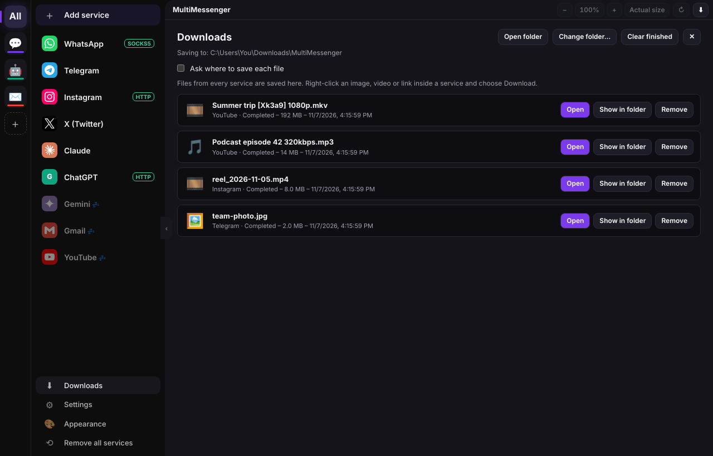

</div>

---

## Why MultiMessenger?

You have a dozen tabs open: WhatsApp, Telegram, mail, three AI chats, Instagram. Some need a proxy, some must not use one, and two of them need a second account. A normal browser makes that painful.

**MultiMessenger gives every service its own space**: its own login, its own proxy, its own zoom and its own notifications, all one click away in a clean sidebar.

> Free, open source and private. No account, no tracking, no server. Everything stays on your computer.

---

## ✨ Highlights

| | |
|---|---|
| 🧭 **24 services built in** | Messaging, work, AI assistants and video, plus **any website** through a custom URL. |
| 🛡️ **A proxy for each service** | HTTP, HTTPS, SOCKS4 or SOCKS5, with optional username and password (SOCKS4 too). Proxy one service, leave another direct. |
| 👥 **Many accounts** | Every service has its own isolated session. Add WhatsApp twice for two numbers. |
| 🔔 **Real notifications** | Website notifications become Windows notifications. Unread counts on the sidebar, the taskbar and the tray. |
| 🗂️ **Workspaces** | Group services into *Social media*, *AI*, *Mail*, *Work* and switch with one click. |
| ⬇️ **Video downloader** | Pick the exact YouTube quality, or download Instagram and Facebook videos in one click. MP4 plus the MKV original. |
| 🎨 **14 themes** | From Windows 11 and GNOME to Windows XP, Classic Mac, MS-DOS and Plan 9. |
| 🔍 **Zoom per service** | Each service remembers its own zoom. |
| 😴 **Always on or asleep** | Keep a service running, or unload it after a few minutes to save memory. |
| 🚀 **Start with Windows** | Optionally minimized to the tray. |

---

## 🧭 Supported services

| Group | Services |
|---|---|
| **Messaging and social** | WhatsApp, Telegram, Instagram, X (Twitter), Facebook, Facebook Messenger, Discord, Element / Matrix |
| **Work** | Gmail, Google Chat, Microsoft Teams, Skype for Business*, Mattermost*, LinkedIn |
| **AI assistants** | ChatGPT, Claude, Gemini, Grok, DeepSeek, GLM (Z.ai), Perplexity, Microsoft Copilot |
| **Video** | YouTube |
| **Anything else** | **Web app (custom URL)**: type an address and it gets its own login, icon and proxy |

\* Skype for Business and Mattermost are hosted by your organization, so you enter your own server address.

The sidebar starts **empty**. You add only the services you want.

---

## 🛡️ A proxy for each service

<table>
<tr>
<td width="55%" valign="top">

Send WhatsApp through one server, keep Gmail on your normal connection, and put Instagram behind another. Each service has its own switch.

- Choose **HTTP, HTTPS, SOCKS4 or SOCKS5**
- Type the address and port, for example `127.0.0.1` and `8080`
- Add a username and password when needed (**SOCKS4 included**)
- **Save & test connection** shows the exit IP the service really uses and how fast the proxy answers
- Proxy passwords are stored encrypted with Windows
- A small tag in the sidebar shows which services use a proxy

</td>
<td width="45%" align="center">

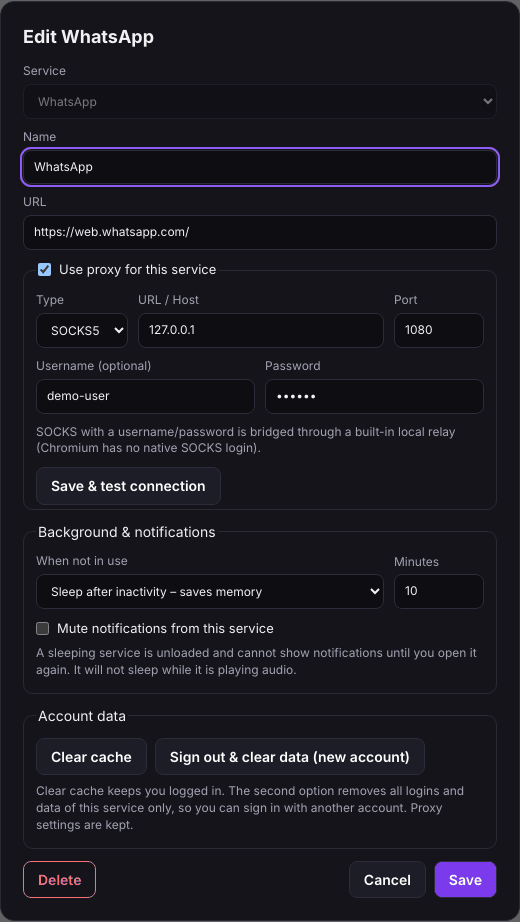

</td>
</tr>
</table>

Need a second account? Add the service again, or open its settings and choose **Sign out & clear data** to start fresh. The proxy settings are kept.

---

## 🔔 Stays connected, tells you when something arrives

- **Notifications**: a website's own notifications become native Windows notifications. Click one to open that service.
- **Unread counts**: red numbers on the sidebar, the taskbar icon and the tray tooltip. Mute any service.
- **Tray and taskbar**: minimize goes to the taskbar, closing the window hides the app in the tray. On Windows 11 the app asks to keep its tray icon visible instead of tucked under the hidden **^** area (Settings → *Keep the tray icon visible*). On Windows 10, drag the icon out of the **^** area once, or use the *open taskbar settings* button.
- **Always on or asleep**: choose per service. Always on keeps messages arriving; sleep unloads a service after the minutes you choose to save memory.
- **Start with Windows**, optionally minimized to the tray.

<div align="center">
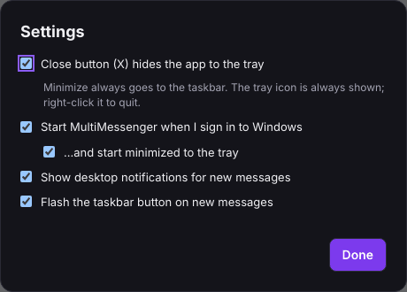
&nbsp;
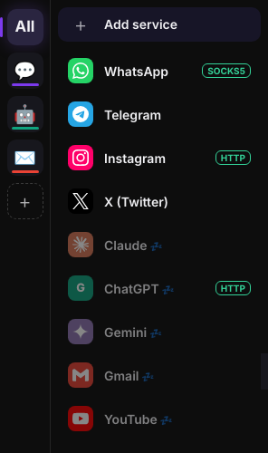
</div>

---

## ⬇️ Video downloader

- **YouTube**: a green **Download as** button next to *Subscribe* lists **every resolution the video has**, plus MP3 and original audio. You get exactly the quality you choose.
- **Instagram**: a download icon next to *Save* on every video post and on Reels. Profiles get *Download All* for the posts already loaded.
- **Facebook and X**: the **⬇ Video** button in the top bar.
- **Any video link**: right-click it and choose *Download video*.
- Every video is saved as **MP4**, and the **MKV original is kept next to it**.
- Your service's own sign-in and proxy are used.
- One **Downloads** section shows progress, pause, cancel, retry, open and show in folder.

Powered by [yt-dlp](https://github.com/yt-dlp/yt-dlp) and ffmpeg, fetched once on first use. Only download what you have the right to.

<div align="center">
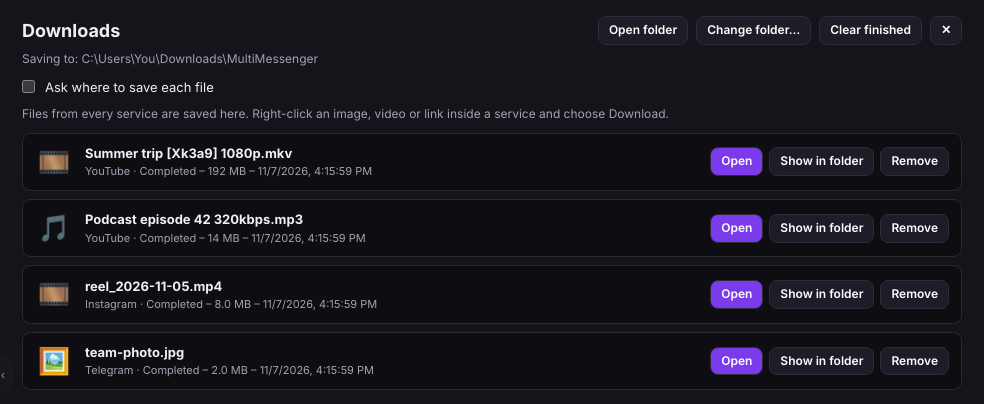
</div>

---

## 🎨 Themes, fonts and zoom

Fourteen themes, a sidebar icon size from 16 to 64 px, and any font installed on your PC, for the app and for the text inside chats (for example Tahoma).

<div align="center">

| Windows XP | Windows 11 | KDE Plasma | GNOME |
|:---:|:---:|:---:|:---:|
| 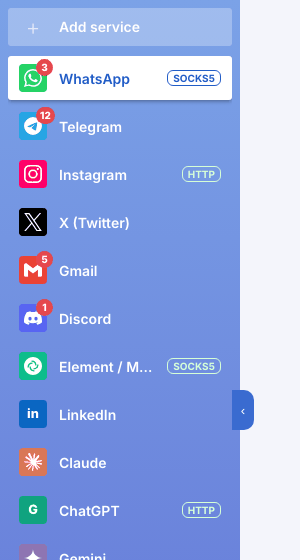 | 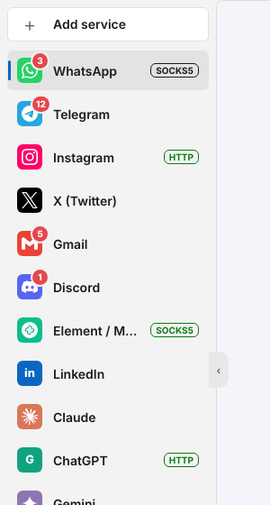 | 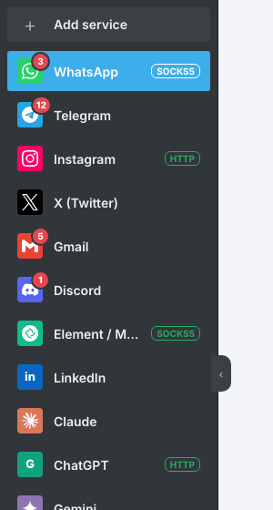 | 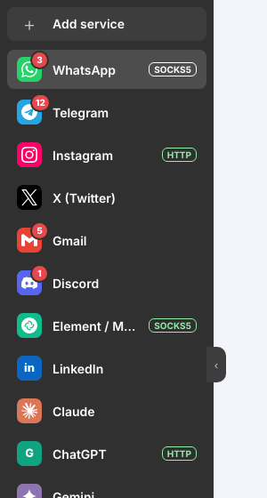 |

| Classic Mac | MS-DOS | 32-bit color | High contrast |
|:---:|:---:|:---:|:---:|
| 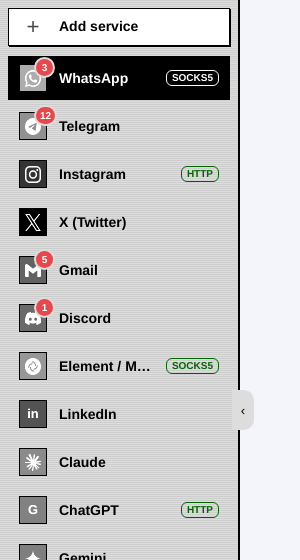 | 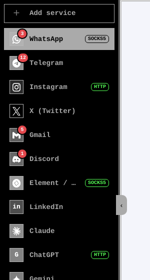 | 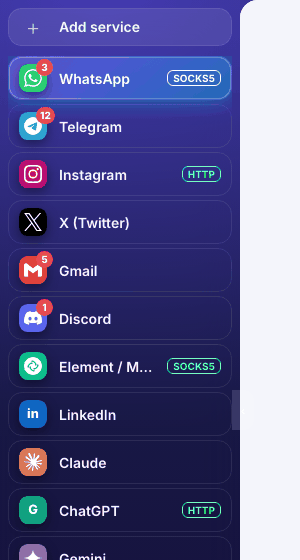 | 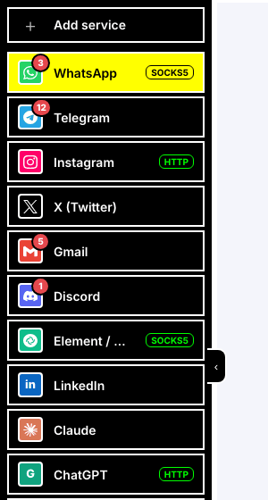 |

</div>

Also included: the default Dark theme, Xfce, Plan 9, and 2-bit, 8-bit and 16-bit color.

Zoom each service with **Ctrl +**, **Ctrl -**, **Ctrl 0** or **Ctrl + mouse wheel**. Each one remembers its own level.

---

## 📥 Install

Download the file for your system from the **[Releases page](https://github.com/nissay87/MultiMessenger/releases/latest)**.

| System | File | How |
|---|---|---|
| **Windows 10 / 11** | `MultiMessenger-x.y.z-win-x64.exe` (installer) or `MultiMessenger-x.y.z-portable.exe` | Run it. |
| **macOS** | `MultiMessenger-x.y.z-mac-arm64.dmg` (Apple silicon) or `-x64.dmg` (Intel) | Open the `.dmg`, drag the app to **Applications**. |
| **Linux** | `.AppImage`, `.deb` or `.tar.gz` | See [Linux](#-linux) below. |
| **Android** | not available | MultiMessenger is a desktop (Electron) app, so there is no APK. |

> The apps are **not code-signed**.
> - **Windows** SmartScreen may say *"Windows protected your PC"*: choose **More info → Run anyway**.
> - **macOS** may say the app *"cannot be opened"*: right-click the app, choose **Open**, then **Open** again. If it still refuses, run `xattr -cr /Applications/MultiMessenger.app` once.

### 🐧 Linux

**AppImage** (works on most distributions, nothing to install):

```bash
chmod +x MultiMessenger-*-linux-*.AppImage
./MultiMessenger-*-linux-*.AppImage
# if it says FUSE is missing:  sudo apt install libfuse2     (Ubuntu / Debian)
# if it says sandbox error:    ./MultiMessenger-*.AppImage --no-sandbox
```

**Debian / Ubuntu** (`.deb`):

```bash
sudo apt install ./MultiMessenger-*-linux-*.deb
# then start MultiMessenger from your application menu
```

**Any distribution** (`.tar.gz`):

```bash
tar -xzf MultiMessenger-*-linux-*.tar.gz
cd MultiMessenger-*-linux-*
./multimessenger            # the file name can differ; run  ls  to see it
```

**From source** (any distribution) needs Node.js and Git:

```bash
git clone https://github.com/nissay87/MultiMessenger.git
cd MultiMessenger
npm install
npm install-scripts approve electron
node node_modules/electron/install.js
npm start
```

---

## 🧰 Helper programs for the video downloader

The downloader needs three small programs. **MultiMessenger can install them for you** (Settings → Video downloader, or the first time you download). If you prefer to install them yourself, use any method below. The app looks for them in this order: the path you set in Settings, its own `tools` folder, a `tools` folder next to the app, then your system `PATH`.

| Program | What it does |
|---|---|
| [yt-dlp](https://github.com/yt-dlp/yt-dlp) | finds and downloads the video |
| [ffmpeg](https://ffmpeg.org/) | merges video and audio, makes MP4 and MP3 |
| [Deno](https://deno.com/) | the JavaScript engine yt-dlp needs for YouTube |

### One-line scripts (recommended)

**Windows** (PowerShell, no admin needed):

```powershell
powershell -ExecutionPolicy Bypass -File scripts\install-tools.ps1
```

**Linux and macOS:**

```bash
bash scripts/install-tools.sh
```

Both scripts put the three programs in the app's `tools` folder, so the app finds them with no further setup:

| System | Folder |
|---|---|
| Windows | `%APPDATA%\multi-messenger\tools` |
| macOS | `~/Library/Application Support/multi-messenger/tools` |
| Linux | `~/.config/multi-messenger/tools` |

### Package managers

**Windows: winget**

```powershell
winget install yt-dlp.yt-dlp
winget install DenoLand.Deno
winget install Gyan.FFmpeg
```

**Windows: Scoop**

```powershell
scoop install yt-dlp deno ffmpeg
```

**Windows: Chocolatey**

```powershell
choco install yt-dlp deno ffmpeg
```

**macOS: Homebrew**

```bash
brew install yt-dlp deno ffmpeg
```

**Linux: Snap**

```bash
sudo snap install yt-dlp
sudo snap install ffmpeg
sudo snap install deno
```

> Snap programs are sandboxed and can only reach files in your home folder, which is fine for the default Downloads folder. If one is missing from the store, use the direct download below.

**Debian / Ubuntu: apt**

```bash
sudo apt install ffmpeg
sudo snap install deno          # or the direct download below
python3 -m pip install -U yt-dlp --break-system-packages    # or: pipx install yt-dlp
```

**Fedora:** `sudo dnf install ffmpeg yt-dlp` (enable RPM Fusion first for ffmpeg) · **Arch:** `sudo pacman -S yt-dlp ffmpeg deno`

### Direct download

Download, then copy the files into the `tools` folder from the table above (or anywhere on your `PATH`).

| | Windows | macOS | Linux |
|---|---|---|---|
| **yt-dlp** | [yt-dlp.exe](https://github.com/yt-dlp/yt-dlp/releases/latest/download/yt-dlp.exe) | [yt-dlp_macos](https://github.com/yt-dlp/yt-dlp/releases/latest/download/yt-dlp_macos) | [yt-dlp_linux](https://github.com/yt-dlp/yt-dlp/releases/latest/download/yt-dlp_linux) |
| **Deno** (zip) | [x86_64 Windows](https://github.com/denoland/deno/releases/latest/download/deno-x86_64-pc-windows-msvc.zip) | [Apple silicon](https://github.com/denoland/deno/releases/latest/download/deno-aarch64-apple-darwin.zip) · [Intel](https://github.com/denoland/deno/releases/latest/download/deno-x86_64-apple-darwin.zip) | [x86_64](https://github.com/denoland/deno/releases/latest/download/deno-x86_64-unknown-linux-gnu.zip) · [ARM64](https://github.com/denoland/deno/releases/latest/download/deno-aarch64-unknown-linux-gnu.zip) |
| **ffmpeg** | [BtbN build (zip)](https://github.com/BtbN/FFmpeg-Builds/releases/latest/download/ffmpeg-master-latest-win64-gpl.zip) · [gyan.dev](https://www.gyan.dev/ffmpeg/builds/) | [ffmpeg.org downloads](https://ffmpeg.org/download.html#build-mac) or `brew` | [static build](https://johnvansickle.com/ffmpeg/) |

On Linux and macOS, make the files runnable: `chmod +x yt-dlp deno ffmpeg`.

### Manual setup in the app

Settings → Video downloader → **Choose yt-dlp…** / **Choose ffmpeg…** lets you point to your own copies anywhere on disk.

---

## 🛠️ Run from source

You need [Node.js](https://nodejs.org/) (current LTS) and [Git](https://git-scm.com/).

```bash
git clone https://github.com/nissay87/MultiMessenger.git
cd MultiMessenger
```

Then, in the project folder:

```bash
npm install
npm install-scripts approve electron
node node_modules\electron\install.js
npm start
```

What each line does:

| Command | Purpose |
|---|---|
| `npm install` | Downloads the dependencies. |
| `npm install-scripts approve electron` | Newer npm versions block Electron's download step. This allows it. |
| `node node_modules\electron\install.js` | Downloads the Electron program itself. On macOS or Linux use `/` instead of `\`. |
| `npm start` | Starts the app. |

After the first time, only `npm start` is needed.

<details>
<summary><b>The Electron download stalls or fails?</b></summary>

Your network may be blocking GitHub. Use a mirror, then run the install step again:

```bat
:: Windows (cmd)
set ELECTRON_MIRROR=https://npmmirror.com/mirrors/electron/
node node_modules\electron\install.js
```

```bash
# macOS / Linux
ELECTRON_MIRROR=https://npmmirror.com/mirrors/electron/ node node_modules/electron/install.js
```

Do not run `npm audit fix --force`. The warnings come from the build tooling and do not affect the running app.

</details>

---

## 📦 Build your own installer

```bash
npm run dist:win       # Windows installer (.exe)   - run on Windows
npm run dist:portable  # Windows portable .exe
npm run dist:msi       # Windows .msi
npm run dist:mac       # macOS .dmg                 - must be run on a Mac
npm run dist:linux     # Linux AppImage, .deb, .tar.gz - run on Linux
```

On Windows open the terminal **as Administrator** (or turn on Developer Mode). The files appear in the `dist` folder. Each system must be built on that system. A DMG can only be built on a Mac and Linux packages on Linux.

### Let GitHub build all of them for you

The repository contains `.github/workflows/release.yml`. Push a version tag and GitHub builds the **Windows, macOS and Linux** files on its own servers and attaches them to a release:

```bash
git tag v1.3.20
git push origin v1.3.20
```

Wait a few minutes, then open **Releases**. (You can also run it by hand from the **Actions** tab.)

Or publish by hand: **Releases → Draft a new release**, create a tag, attach the files from `dist`, and publish.

<details>
<summary><b>Build helpers fail to download?</b></summary>

```bat
set ELECTRON_MIRROR=https://npmmirror.com/mirrors/electron/
set ELECTRON_BUILDER_BINARIES_MIRROR=https://npmmirror.com/mirrors/electron-builder-binaries/
```

</details>

---

## ⚙️ How it works

- Every service is an Electron `<webview>` with its own persistent partition (`persist:svc-<id>`), so logins and proxies never mix.
- HTTP and HTTPS proxies are set per partition with Chromium's native proxy login.
- Chromium cannot sign in to SOCKS proxies. For SOCKS **with** a username and password, [`relay.js`](relay.js) starts a small local HTTP proxy on `127.0.0.1` that forwards through the SOCKS server.
- [`webview-preload.js`](webview-preload.js) replaces the page's `Notification` API with one that reports to the app, which shows a native notification. Unread counts come from the page title, such as `(3) WhatsApp`.

```
main.js                Electron main process: window, tray, proxies, notifications, settings
videodl.js             video downloader (yt-dlp and ffmpeg)
preload.js             safe bridge between the app window and the main process
webview-preload.js     runs inside each service page (notifications, download buttons)
relay.js               local HTTP-to-SOCKS bridge for SOCKS logins
catalog.json           the list of built-in services
renderer/              the app's interface (HTML, CSS, JS, themes, service icons)
assets/                app, window and tray icons (shipped inside the app)
build/                 installer icon files
scripts/               install-tools.ps1 / install-tools.sh (yt-dlp, ffmpeg, Deno)
.github/workflows/     release.yml (builds Windows, macOS and Linux downloads)
docs/                  the GitHub Pages website
```

---

## 🔒 Privacy

MultiMessenger has **no accounts, no analytics and no server of its own**. Services, logins and settings are stored on your computer in `%APPDATA%\multi-messenger`. Proxy passwords are encrypted with the operating system's key store. The only request the app makes for itself is the exit-IP check to `api.ipify.org`, and only when you press **Save & test connection**.

## ⚠️ Known limits

- **Windows is the main system.** The macOS and Linux builds come from the same Electron code, but tray icons, taskbar badges and start-at-login are designed for Windows and have not been tested on macOS or Linux. There is no Android version.
- Google and Facebook sometimes refuse sign-in in embedded browsers ("Couldn't sign you in – this browser or app may not be secure"). The app presents itself as normal Chrome (User-Agent, client hints and browser brand values), which usually works, but a provider can still block it. If it happens: press **Try again**, use **Sign out & clear data** on that service and sign in again, make sure the app is the latest version, and sign in from the service's own page (for YouTube: the *Sign in* button) rather than from a link inside another site. YouTube works without signing in; you only need it for private or age-restricted videos.
- **Google sign-in** (Gmail, YouTube, Google Chat): Google blocks embedded apps, so the app opens Google's sign-in page in its own small window that looks like Firefox, then returns to the service signed in. This works for most accounts, but Google decides, and may still ask for extra verification or refuse. If it does, choose **Sign out & clear data** and try again.
- A sleeping service is unloaded and cannot show notifications until you open it.
- Websites change often. If a service stops working, reload it, clear its cache, or [open an issue](https://github.com/nissay87/MultiMessenger/issues).

## 🙏 Credits and disclaimer

Made by **[nissay87](https://github.com/nissay87)**.

Video downloads use [yt-dlp](https://github.com/yt-dlp/yt-dlp) and [FFmpeg](https://ffmpeg.org/). Service logos are from [Simple Icons](https://simpleicons.org/).

MultiMessenger is an independent project. It is not affiliated with, endorsed by or sponsored by any of the services it can open. Names and logos belong to their owners and are used only to identify the services. You are responsible for following each service's terms of use.

## 📄 License

[MIT](LICENSE) © nissay87

---

<div align="center">

**If MultiMessenger saves you time, please ⭐ star the repository. It helps others find it.**

</div>
